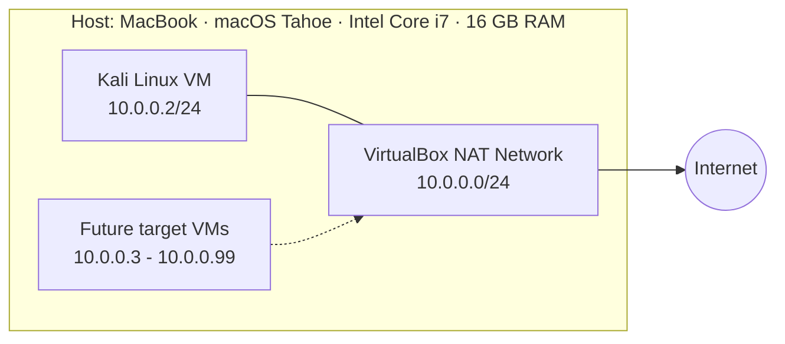

# 🔐 Cybersecurity Lab Environment Setup

**Building an isolated virtual lab for penetration testing and ethical hacking practice — on a Mac**


---

## 📌 Project Overview

This project sets up a **virtual cybersecurity and penetration-testing laboratory** using VirtualBox and Kali Linux, hosted on an Intel-based MacBook running macOS.

The goal is a controlled, isolated environment where security tools, network reconnaissance, port scanning, vulnerability assessment, packet analysis, and other security-testing activities can be practiced **safely and repeatably**.

The lab runs on a private virtual network, so additional machines can be added later and used as targets for authorized security testing.

---

## 🎯 Objectives

- Install and configure VirtualBox on macOS.
- Download the Kali Linux installer ISO and install the VM from scratch (**no 7-Zip or archive extraction needed on macOS**).
- Create a private **NAT Network** for the cybersecurity lab.
- Configure network connectivity for the Kali Linux VM.
- Assign a consistent IP address to the Kali VM.
- Verify network connectivity and DNS resolution.
- Take a clean VM snapshot as a recovery baseline.
- Document the complete setup process.

---

## 🛡️ Purpose of the Lab

The lab provides an isolated environment for cybersecurity learning and authorized security testing, including:

- Network reconnaissance
- Port scanning
- Vulnerability assessment
- Packet analysis
- Web security testing
- Security-tool experimentation

⚠️ **Important:** This laboratory is used only against systems I own or have explicit permission to test. Nothing in this lab is used to attack unauthorized systems.

---

## 🏗️ Lab Architecture



Additional target machines can be attached to the same NAT Network in future projects. The lab architecture plans for these target VMs:

| 🔮 Planned Target VM | 📡 IP Address |
| --- | --- |
| Windows 11 | 10.0.0.11/24 |
| Windows 10 | 10.0.0.10/24 |
| Windows 7 | 10.0.0.7/24 |
| Windows Server 2016 | 10.0.0.16/24 |
| Android VM | 10.0.0.9/24 |

---

## ⚙️ Lab Configuration

| 🧩 Component | ⚙️ Configuration |
| --- | --- |
| 🖥️ Host OS | macOS 26 Tahoe (Intel) |
| 🧠 Host RAM | 16 GB |
| ⚡ Processor | Intel Core i7 |
| 🧰 Hypervisor | VirtualBox 7.2.22 |
| 🐉 Security OS | Kali Linux 2026.3 |
| 🧠 Kali RAM | 2048 MB |
| 🌐 Virtual Network | NAT Network |
| 📡 Network Address | 10.0.0.0/24 |
| 🐧 Kali IP Address | 10.0.0.2/24 |
| 🚪 Default Gateway | 10.0.0.1 |
| 🌍 DNS Server | 8.8.8.8 |
| 🔮 Future VM Range | 10.0.0.3–10.0.0.99 |

---

## 🪜 Lab Setup Procedure

### Step 1. Download the Kali Linux ISO

The official Kali Linux installer ISO was downloaded from the Kali website.

Instead of importing the prebuilt VirtualBox machine image (distributed as a `.7z` archive), I installed Kali from the ISO — an approach I was already comfortable with from using the UTM hypervisor on macOS. This also meant no archive-extraction tool was needed on the Mac.

### Step 2. Install VirtualBox

VirtualBox was installed as the hypervisor for the lab.

### Step 3. Create the NAT Network

A dedicated NAT Network was created in VirtualBox:

```text
Network Name: NatNetwork
IPv4 Prefix:  10.0.0.0/24
DHCP:         Enabled
IPv6:         Disabled
```

A **NAT Network** was chosen over standard NAT because every VM attached to it can communicate with the others while still reaching the Internet. This is what will let future attacker and target VMs talk to each other inside the lab.

### Step 4. Create & Install the Kali Linux VM

A new virtual machine was created in VirtualBox, attached to the Kali ISO, and Kali Linux was installed from the installer. The VM's network adapter was then configured:

```text
Adapter 1
Attached to: NAT Network
Network:     NatNetwork
Adapter Type: Intel PRO/1000 MT Desktop
```

The VM was allocated:

```text
RAM: 2048 MB
```

### Step 5. Configure the Kali Linux Network

Kali was given a consistent IPv4 address:

```text
IP Address:  10.0.0.2
Subnet Mask: 255.255.255.0
Gateway:     10.0.0.1
DNS:         8.8.8.8
```

A fixed IP keeps documentation consistent and makes the Kali machine easy to reference in future exercises.

### Step 6. Create a Clean VM Snapshot

After the initial configuration, a snapshot was taken as the clean baseline:

```text
Snapshot name: Snapshot 1
```

If a future exercise ever breaks or changes the VM, it can be rolled back to this known-good state in seconds.

---

## 📸 Screenshots

**1. Lab architecture overview**


**2. VirtualBox NAT Network settings**


**3. Kali Linux running in VirtualBox**


**4. Kali Linux network configuration**


---

## 🔎 Lab Verification

| ✅ Test | 🧾 Command | 🎯 Expected Result |
| --- | --- | --- |
| 🌐 Check IP address | `ip a` | Correct Kali IP displayed |
| 📡 Test gateway | `ping 10.0.0.1` | Successful replies |
| 🌍 Test Internet connectivity | `ping 8.8.8.8` | Successful replies |
| 🔎 Test DNS resolution | `nslookup networkwalks.com` | Domain resolves |
| 🧰 Verify Nmap | `nmap --version` | Nmap version displayed |
| 🔄 Verify snapshot | Restore snapshot, run `ip a` | Baseline configuration restored |

---

## 🐞 Problems Encountered & Decisions

Documenting problems and choices is part of a professional security project.

### Decision 1: Prebuilt VM image vs. ISO install

Kali offers both a prebuilt VirtualBox machine image (a `.7z` archive) and a plain installer ISO.

**Decision:** I installed from the ISO. I was already familiar with ISO-based installs from using UTM on macOS, and it meant the lab needed no archive-extraction tooling on the Mac.

---

## 💡 What I Learned

Building this lab taught me how to create and configure a safe virtual environment for security work:

- **NAT vs NAT Network** — a NAT Network lets multiple VMs communicate with each other while still reaching the Internet, which is what makes a multi-machine lab possible.
- **VM networking** — how virtual adapters attach VMs to different network types, and how that shapes communication between machines.
- **Static IP configuration** — configuring and verifying IPv4 address, subnet mask, gateway, and DNS in Kali Linux.
- **VM snapshots** — learned firsthand that a clean snapshot should be taken **before** any risky or experimental work; it is the recovery point for every future exercise.
- **Documentation** — recording commands, configuration, screenshots, problems, and solutions is what turns a lab exercise into a professional project.

Having used UTM on macOS before, I had basic familiarity with virtual machines, but this project was my first time building a structured, networked lab the way security professionals do.

---

## 🔐 Security & Ethical Use

This laboratory is strictly for educational purposes. All testing is confined to systems I own or am explicitly authorized to test.

---

## 🔗 Tools & Resources

- **VirtualBox:** https://www.virtualbox.org/wiki/Downloads
- **Kali Linux:** https://www.kali.org/get-kali/

---

## 👤 Author

**Oluwatobiloba Aina**
Cybersecurity Student — NetworkWalks

LinkedIn: https://www.linkedin.com/in/tobiloba-aina-78483822b/

---

## 📌 Project Information

| Field | Value |
| --- | --- |
| Program | Cybersecurity at NetworkWalks |
| Week | 01 |
| Project | Cybersecurity & Pentesting Lab Setup |
| Platform | GitHub |
